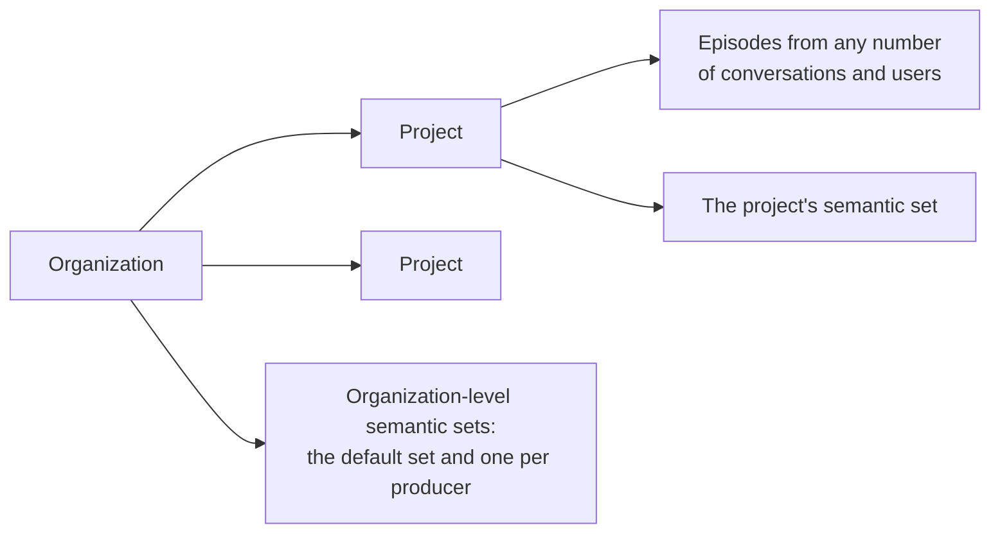

# Data model and tenancy

> Retroactive design document: it describes the system as built, written
> after the decisions it covers were made.

## Tenancy

Every memory request names an organization and a project. A project is one
session inside the server, keyed by `org_id/project_id`. Its episodes and
episodic memory live in partitions of their own, and episodic searches and
lists run within the project. Semantic memory also has organization-level
sets, which every project in the organization reads and writes (see
[Semantic sets](#semantic-sets)).

The server acts on whichever organization and project a request names.
Authenticating the caller and checking which organizations and projects it
may use belong to the deployment in front of the server (see
[server and API](server_and_api.md)).

A project holds every conversation and user that the application sends to
it. The application tells conversations and users apart through each
episode's producer and metadata, and narrows searches with filters on them.
An application that keeps two users' memories apart without filters gives
each its own project.

An add or search that reaches episodic memory creates the project if it does
not exist ([#1576](https://github.com/MemMachine/MemMachine/issues/1576)).

## Deleting a project

Deleting a project marks it deleted, so requests for it stop at once. A
background task in any server process then deletes its episodes, its
episodic memory, and the features of the project's semantic set and of the
organization's default set. Organization-level sets other than the default
set, such as per-producer sets, keep their features, minus their citations
of the project's episodes. Semantic configuration stays.

## Episodes

An episode is one message or event. Its fields, as the API names them:

| Field | Meaning |
|---|---|
| `content` | The text. |
| `producer` | Who produced it: the speaker's name, shown to models, and the identity that per-producer semantic sets are keyed by. |
| `role` | The producer's role, such as user or assistant. |
| `produced_for` | Optionally, who it was addressed to. |
| `timestamp` | When it happened. The server fills in the time of the request when it is omitted. Retrieval reads it as the time of the event. |
| `metadata` | Key-value pairs for filtering. |

The server assigns each episode its id. Episodes are immutable: an
application deletes an episode by id and adds a corrected one.

The episode store keeps the raw episodes, and each memory type keeps its own
derived representation of them. Deleting an episode removes it from the
episode store and from long-term episodic memory, and removes it from
semantic memory's history and from the citations of the features extracted
from it. The features themselves stay until they are deleted, and the
short-term summary keeps what it already absorbed
([#1884](https://github.com/MemMachine/MemMachine/issues/1884)).

## Filters

A search or list takes an optional filter over metadata and system fields:
comparisons (`=`, `!=`, `<`, `<=`, `>`, `>=`), `IN`, and `IS NULL`, combined
with `AND`, `OR`, and `NOT`. Metadata keys are written `metadata.<key>` or
`m.<key>`.

Each memory type applies the filter in its own stores. A vector store
filters only on the properties its schema declares, which are the system
fields and not arbitrary metadata keys. So in the event backend the vector
search applies the declared part of a filter, and the whole filter then
applies to the candidates it returned. A filter that matches few of a
project's episodes can therefore return fewer results than the limit
([#1829](https://github.com/MemMachine/MemMachine/issues/1829)).

## Semantic sets

Semantic memory groups its features into sets by subject. Every organization
has a default set, every producer has an organization-level set, and every
project has a set of its own. Set types add sets keyed by metadata tags, at
the project or organization level. See [semantic memory](semantic_memory.md).

## Open problems

- The producer is both a display name and an identity, and the episode
  fields carry other ambiguities; [#1909](https://github.com/MemMachine/MemMachine/issues/1909)
  proposes replacing the episode with the event model of the event backend.
- "Session" names a project's whole memory scope but reads as one
  conversation ([#1812](https://github.com/MemMachine/MemMachine/issues/1812)).
- A retried add stores the episodes again, since callers cannot supply their
  own ids ([#1919](https://github.com/MemMachine/MemMachine/issues/1919)).
