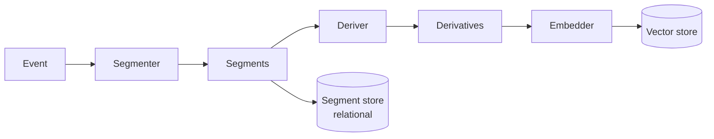

# Episodic memory

> Retroactive design document: it describes the system as built, written
> after the decisions it covers were made.

## Purpose

Episodic memory answers "what was said or done, and in what context". It
returns stored episodes that match a query and, when the request sets
`expand_context`, the episodes around each match, so a model can see a match
in its conversation rather than as an isolated line.

Each project has one episodic memory, made of two parts:

- **Short-term memory**: a running summary of the project and its most
  recent episodes.
- **Long-term memory**: an index of every episode, searched by similarity.

A search returns both: the short-term summary and recent episodes as they
are, and the long-term matches with their scores.

## Short-term memory

Short-term memory keeps recent episodes in a window bounded by total message
length, plus a summary. When the window overflows, a language model folds the
window into the summary. The summary is saved in the relational database
with the session.

The window lives in the episodic memory instance that a server process opens
for the session, and it lasts only as long as that instance stays open. With
`instance_cache_size` at its default of zero, an instance closes when its
last request finishes, so each request starts with an empty window and the
saved summary. With a cache, a window lives in one process, and processes do
not share it ([#1748](https://github.com/MemMachine/MemMachine/issues/1748)).
The summary does not record which episodes it covers
([#1884](https://github.com/MemMachine/MemMachine/issues/1884)).

## Long-term memory

Each project uses one of two long-term backends. A project created without a
choice gets the backend that the server configuration names, or declarative
if the configuration names none.

### Event backend

Ingest:

1. Each episode becomes an event.
2. A segmenter splits the event into segments: one segment per event by
   default, or several pieces of a long message with the text segmenter.
3. A deriver turns each segment into derivative text for embedding, such as
   the producer's name and the segment's text.
4. The embedder embeds each derivative.
5. The segment store saves the segments, in order, and which derivatives
   came from each; the vector store saves each derivative's vector.

Query:

1. Embed the query and search the project's partition of the vector store
   for the nearest derivatives, applying the part of the filter the vector
   store can apply.
2. Look up the segments those derivatives came from, the seeds, and apply
   the whole filter to them.
3. When the request sets `expand_context`, add the segments before and after
   each seed from the segment store.
4. Rerank the segments with the configured reranker, or keep the similarity
   scores when there is none.
5. Return the episodes those segments belong to, read from the episode
   store.

The vector store holds only what is searched, the derivatives. The segment
store holds the segments in order, which context expansion walks and the
reranker reads. The episode store holds what the caller gets back. So what
is embedded can differ from what is reranked and from what is returned.

On PostgreSQL with Qdrant or Milvus, both stores serve a project from any
server process (see [storage](storage.md) and
[deployment and scaling](deployment_and_scaling.md)).

### Declarative backend

The declarative backend keeps episodes and their derived text as nodes in a
graph database (Neo4j or NebulaGraph), with embeddings on the derivative
nodes. A search finds the nearest derivatives, follows them to their
episodes, adds neighboring episodes when the request asks for context, and
reranks; the backend requires a reranker.

Its scope is a single server process, since it keeps per-process caches of
what the database holds
([#1753](https://github.com/MemMachine/MemMachine/issues/1753)).

## Reranking and scores

A reranker reorders candidates by relevance to the query. The choices are a
cross-encoder, a hosted reranker (Cohere or Amazon Bedrock), BM25, an
embedding-similarity reranker, or a reciprocal rank fusion of several
rerankers. The event backend can also run without one.

Long-term results come back in chronological order with their scores,
except that the event backend without context expansion returns them in
score order.

`limit` bounds the long-term results and, separately, the short-term ones;
a search may return fewer. `score_threshold` drops long-term results that
score worse than it. What a score means depends on the reranker, the
similarity metric, the query, and the corpus, so a threshold tuned for one
setup does not carry to another.

## Retrieval agent

In agent mode, the retrieval agent plans before it searches. A language
model decides how to handle the question: answer it with one search, split
it into sub-questions, or chain searches where one answer feeds the next
query. The agent runs those searches against long-term memory and merges
their results. It suits multi-part questions, at the cost of sequential
language-model calls before the results return.
