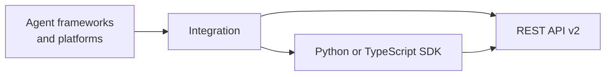

# Integrations and examples

> Retroactive design document: it describes the system as built, written
> after the decisions it covers were made.

## How they relate to the server

Every integration and example is a client of the REST API. Most go through
the Python SDK (`memmachine-client`) or the TypeScript SDK
(`@memmachine/client`); a few call the API over HTTP directly. The LangGraph
tools ship inside `memmachine-client`; the rest sit outside any server or SDK
distribution, so a change to the API reaches them only through the SDKs they
call.

An integration adapts MemMachine to a framework's own memory or tool
interface. It decides how the framework's users, conversations, and agents
map onto projects, producers, and metadata, and how search results become
the text or tool output the framework expects. Those choices differ from one
framework to the next.

## Inventory

| Path | Kind | Calls |
|---|---|---|
| `integrations/aws_strands_agent_sdk` | Strands Agents tools | Python SDK |
| `integrations/strands-memmachine` | Strands Agents memory tool, packaged | HTTP |
| `integrations/crewai` | CrewAI | Python SDK |
| `integrations/langchain` | LangChain | Python SDK and HTTP |
| `integrations/langgraph` | LangGraph demo, using the tools in `memmachine_client.langgraph` | Python SDK |
| `integrations/llamaindex` | LlamaIndex | Python SDK |
| `integrations/dify` | Dify plugin | HTTP |
| `integrations/fastgpt` | FastGPT plugin, as a prebuilt bundle without source | |
| `integrations/n8n` | n8n; documentation only, with the node's code in [MemMachine/n8n-nodes-memmachine](https://github.com/MemMachine/n8n-nodes-memmachine) | |
| `integrations/openclaw` | OpenClaw plugin | TypeScript SDK |
| `packages/skills` | An agent skill for coding agents | `mem-cli` |
| `examples/simple_chatbot` | A chatbot that puts memory into its prompt | HTTP |
| `examples/openai_agent`, `examples/qwen_agent` | Agents with memory tools | Python SDK |
| `examples/memmachine_client_demo.py`, `examples/ts_rest_client_demo` | SDK walkthroughs | Python SDK, TypeScript SDK |
| `examples/MemMachine_V2_Complete_Guide.ipynb` | A notebook tour of the API | HTTP |
| `examples/v1` | Domain assistants written for the removed v1 API | HTTP |
| `tools/chatgpt2memmachine` | Imports a ChatGPT export into MemMachine | HTTP |

The documentation site also has setup guides for platforms with no code in
this repository, such as the GPT Store and Google ADK.

## Maintenance

Tests and type checks run on `packages/`; ruff also lints integrations and
examples, under relaxed rules. No pull-request CI installs or runs an
integration or example against the SDK and server in the same commit, so an
API or SDK change can break one without failing any check.

Each integration and example needs an owner and one of three dispositions:
maintain it with CI and the same checks as `packages/`, move it to its own
repository with its own CI and releases (as the n8n node did), or remove it.
[#1908](https://github.com/MemMachine/MemMachine/issues/1908) tracks the
disposition of each.
