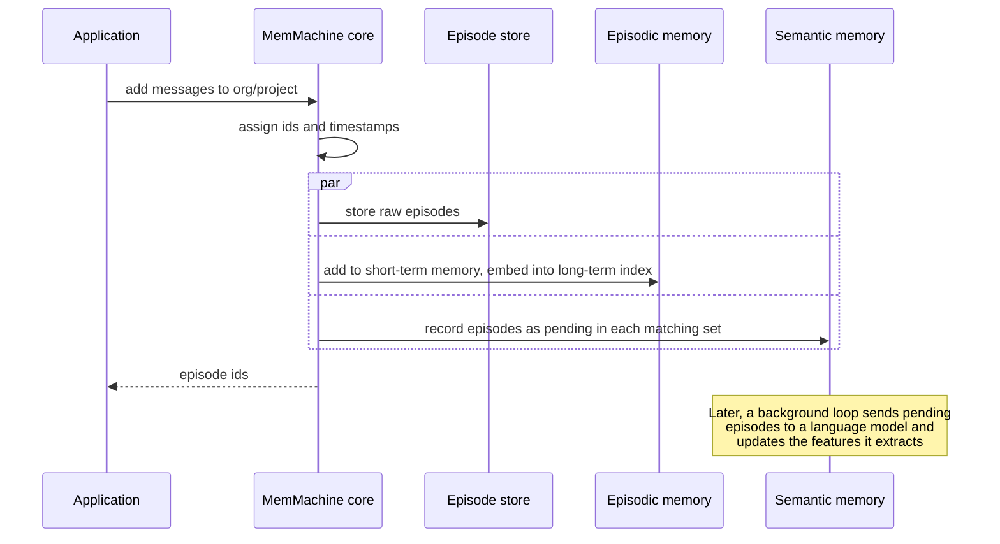
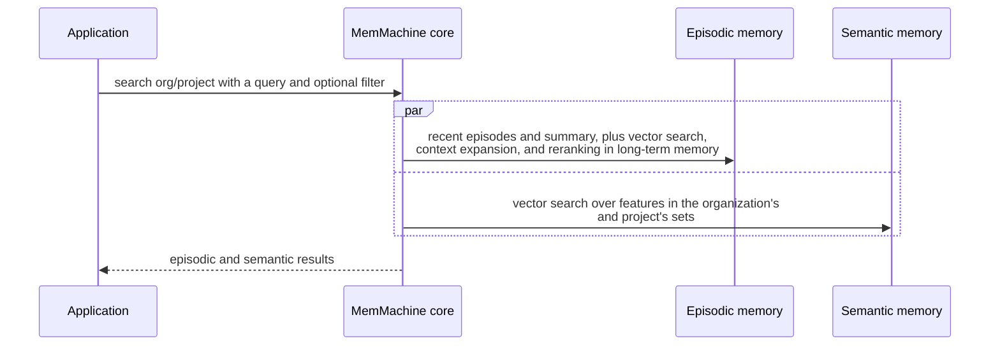

# MemMachine overview

> Retroactive design document: it describes the system as built, written
> after the decisions it covers were made.

## What MemMachine is

MemMachine is a memory layer for applications and agents built on language
models. An application sends it what happens in a conversation, one message
or event at a time. MemMachine stores each one and, when asked a question,
returns what is relevant to it:

- **Episodic memory**: earlier messages that match the query and, when the
  request asks for it, the messages around them.
- **Semantic memory**: facts about users and topics that a language model
  extracted from the messages, such as preferences, profile details, and
  domain-specific attributes.

The application puts the results into its own prompt. MemMachine decides
what to store and how to retrieve it; the application decides what to do
with what comes back.

MemMachine runs as a server. Applications call it over a REST API, through
the Python and TypeScript SDKs that wrap that API, or through an MCP server
for agents that speak the Model Context Protocol.

## Components

```mermaid
flowchart TB
    subgraph clients[Clients]
        sdk[Python and TypeScript SDKs]
        mcpc[MCP clients]
        integ[Integrations and examples]
        cli[mem-cli and the agent skill]
    end

    subgraph server[memmachine-server]
        rest[REST API v2]
        mcps[MCP server]
        core[MemMachine core]
        episodic[Episodic memory<br/>short-term and long-term]
        semantic[Semantic memory]
        agent[Retrieval agent]
        resources[Resource manager]
    end

    subgraph models[Model providers]
        embedders[Embedders]
        llms[Language models]
        rerankers[Rerankers]
    end

    subgraph stores[Databases]
        sql[(Relational<br/>PostgreSQL or SQLite)]
        vector[(Vector<br/>Qdrant, Milvus, or SQLite)]
        graph[(Graph<br/>Neo4j or NebulaGraph)]
    end

    sdk --> rest
    integ --> sdk
    integ --> rest
    cli --> sdk
    mcpc --> mcps
    rest --> core
    mcps --> core
    core --> episodic
    core --> semantic
    core --> agent
    agent --> episodic
    episodic --> resources
    semantic --> resources
    resources --> models
    resources --> stores
```

| Component | Role |
|---|---|
| REST API and MCP server | Validate requests, map them to the core's operations, and map failures to HTTP statuses. See [server and API](server_and_api.md). |
| MemMachine core | Owns projects and their lifecycle. On add, it stores each episode and hands it to the memory types. On search, it queries them in parallel and returns their results together. |
| Episodic memory | Short-term memory: a running summary of the session and its most recent episodes. Long-term memory: a searchable index of every episode. See [episodic memory](episodic_memory.md). |
| Semantic memory | Features that a language model extracts from episodes in the background, grouped into sets and categories. See [semantic memory](semantic_memory.md). |
| Retrieval agent | An optional planner that uses a language model to split a question into several episodic searches and combine their results. |
| Resource manager | Builds the embedders, language models, rerankers, and databases that the configuration declares, and hands them to the components that refer to them by id. |

## Adding memories



The episode store holds the raw episodes; every memory type keeps a derived
index of them. The three writes are independent of one another: if one
fails, the others are not undone ([#1738](https://github.com/MemMachine/MemMachine/issues/1738)).

Adding a message embeds text right away, at the embedder's cost. Semantic
extraction runs later, so its language-model cost is not on the request's
path. A new fact therefore shows up in semantic search only after the next
ingestion round.

## Searching memories



A search embeds the query for each memory type it searches and reranks
long-term candidates when a reranker is configured. In agent mode the retrieval agent
first makes language-model calls to plan its searches, so it trades latency
and model cost for answers to multi-part questions.

## Packages and directories

| Path | Distribution | Contents |
|---|---|---|
| `packages/server` | `memmachine-server` | The server, the memory types, the store interfaces and their backends, the model adapters, and the MCP server (stdio and HTTP) |
| `packages/common` | `memmachine-common` | The API's request and response models, shared by the server and the Python SDK |
| `packages/client` | `memmachine-client` | The Python SDK and `mem-cli` |
| `packages/ts-client` | `@memmachine/client` | The TypeScript SDK |
| `packages/meta` | `memmachine` | Installs the server and the client together |
| `packages/skills` | | An agent skill that teaches coding agents to use `mem-cli` |
| `integrations/`, `examples/` | | Clients of the API for agent frameworks and platforms; see [integrations and examples](integrations_and_examples.md) |
| `evaluation/` | | Benchmarks; see [evaluation](evaluation.md) |
| `deployments/helm`, `docker-compose.yml` | | Deployment artifacts; see [deployment and scaling](deployment_and_scaling.md) |
| `sample_configs/` | | Example server configurations |
| `tools/` | | A capacity sizing tool, a ChatGPT export importer, a data dump script, and an API reference generator |
| `docs/` | | The user documentation site: installation, configuration, and API reference |

## Glossary

| Term | Meaning |
|---|---|
| Organization (`org_id`) | The top-level namespace a request names. An organization exists through its projects and its organization-level semantic settings; it has no lifecycle of its own. |
| Project (`project_id`) | A memory scope inside an organization, created through the API or by the first add or search that reaches episodic memory, and deleted through the API. It holds every conversation and user that the application sends to it. The settings a project can choose are in [server and API](server_and_api.md#configuration). |
| Session (`session_key`) | The server's internal name for a project's memory scope, `org_id/project_id`. It is not a conversation ([#1812](https://github.com/MemMachine/MemMachine/issues/1812)). |
| Episode | One stored message or event: content, producer, role, timestamp, and metadata. |
| Producer | Who produced an episode. It is both the speaker name that models see and the identity that per-producer semantic sets are keyed by ([#1909](https://github.com/MemMachine/MemMachine/issues/1909)). |
| Metadata | Key-value pairs on an episode, available to filters. |
| Short-term memory | A language-model summary of a session, plus its most recent episodes while the session stays open in a server process. |
| Long-term memory | The searchable index of all of a session's episodes, on one of two backends. |
| Declarative backend | The long-term backend that stores episodes and their derived text in a graph database. |
| Event backend | The long-term backend that stores events as segments in a relational segment store and their embeddings in a vector store. |
| Segment, derivative | In the event backend, a segment is a piece of an event, and a derivative is text derived from a segment for embedding. |
| Feature | One fact in semantic memory: a category, a tag, a name, a value, and citations of the episodes it came from. |
| Set, set type | A set groups the features about one subject: an organization, a project, a producer, or a combination of metadata tags. A set type defines which subjects get sets. |
| Category | A kind of feature to extract, defined by a prompt, such as a user profile or coding style. |
| Partition | One tenant's slice of a shared store. |
| Resource | A model or database defined once in the configuration and referred to by id. |
| Agent mode | Search through the retrieval agent instead of a single episodic query. |
