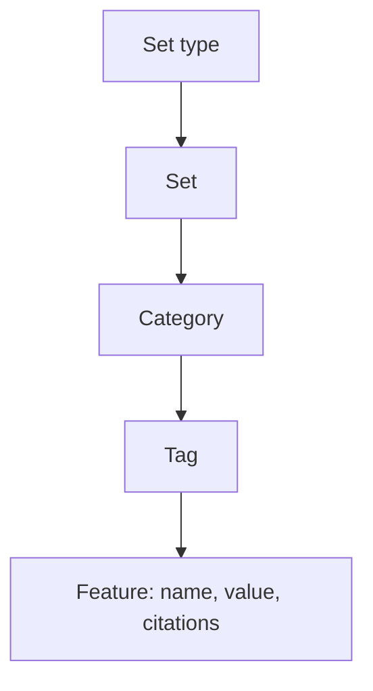

# Semantic memory

> Retroactive design document: it describes the system as built, written
> after the decisions it covers were made.

## Purpose

Semantic memory answers "what do we know about this user or topic". A
language model reads episodes and maintains features: short statements such
as a user's preferred language, their role, or a coding convention they
follow. Features persist across conversations, can be read and edited
through the API, and cite the episodes they came from.

## Structure



| Concept | Meaning |
|---|---|
| Set | The features about one subject, identified by a set id. Every organization has a default set, every producer an organization-level set, and every project a set of its own. |
| Set type | Adds sets keyed by chosen metadata tags, for each project or across the organization. |
| Category | A kind of feature to extract, defined by a prompt. The server ships prompts for a user profile, coding style, a writing assistant, a financial analyst, a health assistant, and CRM. By default only project sets run a category, the user profile; the other sets extract nothing until categories are added. Categories can be added to a set or a set type, disabled for a set, and deleted. |
| Tag | A subdivision of a category, such as "Communication Style" or "Hard Skills" within the user profile. |
| Feature | One fact: category, tag, name, value, and the ids of the episodes it cites. |

## Ingestion

```mermaid
sequenceDiagram
    participant Core as MemMachine core
    participant Storage as Semantic storage
    participant Loop as Background ingestion
    participant LLM as Language model
    Core->>Storage: record episode ids as pending in each matching set
    loop on an interval, in each server process
        Loop->>Storage: find sets with enough pending episodes, or old ones
        Loop->>Storage: take a few pending episodes of each set
        loop each episode, each category of the set
            Loop->>LLM: the episode and the category's existing features
            LLM-->>Loop: commands to add or delete features
        end
        Loop->>Storage: apply the commands, mark the episodes ingested
        Loop->>LLM: consolidate a tag that has grown past a threshold
    end
```

Adding an episode only records it as pending in each set it belongs to.
Extraction happens later, in a background loop, so its language-model
latency stays off the add path.

The consequences:

- **Eventual consistency.** A fact appears in semantic search only after the
  round that extracts it.
- **Cost.** The loop makes one language-model call per pending episode, per
  category, per set the episode was recorded in, plus consolidation calls.
  Cost grows with message volume and with the categories configured, not
  with search traffic. An update call sees a bounded number of the
  category's existing features.
- **Model judgment.** What becomes a feature, and when features merge, is
  the model's decision under the category's prompt. Domain-specific
  extraction is a matter of writing categories, not code.

## Search

A search embeds the query and finds the nearest features in the
organization's default set, the project's set, the set of a producer that
the search's set metadata names, and the sets of set types whose tags that
metadata supplies. A filter narrows the features, and `limit` applies per
set. Features return as structured records, so an application can render
them as a profile instead of as conversation text.

## Storage

Features, their embeddings, and the pending history live in semantic
storage, on PostgreSQL with pgvector, on Neo4j, or on a vector store with a
relational database. Set types, categories, tags, and set configuration live
in a relational configuration store.

## Scope

Semantic memory's scope is a single server process. Every process runs the
ingestion loop, with no claim on the sets it works on, so several processes
ingest the same episodes
([#1745](https://github.com/MemMachine/MemMachine/issues/1745)), and the
configuration cache is per process
([#1747](https://github.com/MemMachine/MemMachine/issues/1747)).
