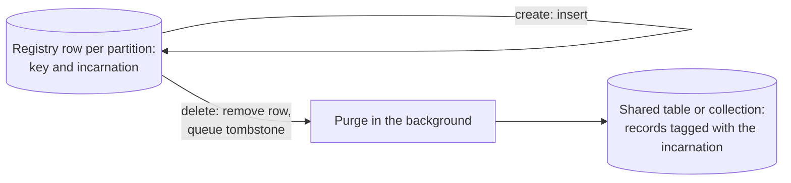

# Storage

> Retroactive design document: it describes the system as built, written
> after the decisions it covers were made.

## Stores and their backends

MemMachine keeps its data in several stores. Each is an interface in
`memmachine_server.common` or in the memory type that owns it, with one or
more backends behind it. The memory types depend only on the interfaces;
the resource manager builds the backends that the configuration names.

| Store | Holds | Backends |
|---|---|---|
| Episode store | Raw episodes, the source of every memory's index | PostgreSQL, SQLite |
| Session data | Projects (sessions), their configuration, status, and short-term summary | PostgreSQL, SQLite |
| Segment store | The event backend's segments: content, order, and properties | PostgreSQL, SQLite |
| Vector store | The event backend's embeddings, and the vectors of one semantic storage backend | Qdrant, Milvus, SQLite with an in-process index, sqlite-vec |
| Vector-graph store | The declarative backend's episodes, derivatives, and embeddings | Neo4j, NebulaGraph |
| Semantic storage | Features, their embeddings, and pending history | PostgreSQL with pgvector, Neo4j, a vector store with a relational database |
| Semantic configuration | Set types, categories, tags, and set configuration | PostgreSQL, SQLite |
| Partition registry | Which partitions of a Qdrant or Milvus store exist, and their lives | PostgreSQL, SQLite |
| Leases | Exclusive leases for background tasks that one process at a time runs | PostgreSQL, SQLite |

The Compose file and the Helm chart run PostgreSQL for every relational store
and the segment store, with Qdrant for vectors. A local deployment
can run everything on SQLite files. The declarative backend adds Neo4j or
NebulaGraph.

Adding a backend means implementing a store's interface and passing the
tests shared by that interface's backends. The interface's docstrings state
the contract: what a caller may rely on and what each backend must
guarantee.

## Multi-tenancy

The stores that serve many processes hold all tenants in shared physical
structures: shared tables in the relational stores, and one native collection
per vector store on Qdrant and Milvus. A tenant's data is a partition inside
those structures, keyed by the partition's identity, not a table or
collection of its own. The SQLite vector stores, which serve one process or
one host, keep tables and a search index per partition and drop them when the
partition is deleted.

- **Create** is a row insert in a registry, arbitrated by the database's
  primary key, so any process may create and a race has one winner.
- **Each life is distinct.** A partition gets a fresh random incarnation
  when it is created, and its records carry it. A partition deleted and
  created again under the same key starts empty, and a handle opened on the
  old life cannot reach the new one.
- **Delete** is logical and immediate: one transaction removes the registry
  row and queues a tombstone. The data is unreachable at once and reclaimed
  in the background by any process, after a retention period on Qdrant and
  Milvus.

The reasons: the target tenant counts make per-tenant tables or collections
too costly in catalog size, locking, and creation time, and every
server process must be able to serve every tenant. The measurements behind
the choice and the full design are in
[segment store shared tables](segment_store_shared_tables.md) and the
[vector store documents](vector_store_horizontal_scaling.md).

## Schemas

Each vector store has a fixed schema, built from the deployment's
configuration: a dimensionality, a similarity metric, and the properties it
declares. Every partition of the store shares it. A store filters only on
the properties it declares, so a project's arbitrary metadata keys are
filtered after the vector search (see [data model](data_model.md)).

Each store creates its relational schema when the server first uses it.
Moving schema creation and migration into one provisioning step, run before
servers start, is open ([#1570](https://github.com/MemMachine/MemMachine/issues/1570)).

## Consistency and deletion

What a query sees of earlier writes, how many processes may serve a
partition, and when deletion reclaims space differ by backend. The vector
store guarantees are tabulated in
[vector store horizontal scaling](vector_store_horizontal_scaling.md#guarantees-by-store).
In short, the SQLite backends are bounded to one process or one host, and
Qdrant and Milvus serve a partition from any process that shares their
registry.

Deleting a project marks its session deleted, and a background task then
deletes the project's data ([data model](data_model.md#deleting-a-project)
lists what it covers). A lease in the relational database keeps
two processes from deleting the same project at once. Erasure is therefore
asynchronous: a deleted project is unreachable at once, and its data is
removed afterward.

## Encryption

The segment store passes each segment's content and context through a
payload codec before storing it; its properties, which filters read, stay
outside the codec. The only codec is plaintext, so encryption at rest is the
databases' job. An encrypting codec would make content opaque to the
database while filters keep working on properties; a filterable field cannot
be encrypted and still be filtered, which is one reason
[#1909](https://github.com/MemMachine/MemMachine/issues/1909) separates
identities from names.
